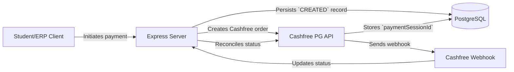

# Cashfree Payment Integration (University Management System - UMS/ERP)

Production‑ready backend payment integration service for a University Management System (UMS/ERP) using **Cashfree Payment Gateway Sandbox**, **Node.js**, **Express.js**, and **PostgreSQL**.

---

## Architecture Overview



### Key Architectural Safeguards
1. **Never Trust the Client** – Merchant `order_id`, `student_id`, and status values are generated/verified on the backend.
2. **Deterministic State Machine** – `CREATED → PENDING → PAID / FAILED / CANCELLED / REQUIRES_RECONCILIATION`.
3. **Downgrade Prevention** – A confirmed `PAID` order never moves to a lower state.
4. **Idempotency & Deduplication** – Webhook events are hashed and stored to avoid duplicate processing.
5. **Row‑Level Transaction Locking** – `SELECT … FOR UPDATE` ensures safe concurrent updates.
6. **Ambiguous Outcome Recovery** – Timeouts/504 responses move the record to `REQUIRES_RECONCILIATION` for later reconciliation.
7. **Zero Secret Leakage** – Secrets are read from environment variables only.

---

## Tech Stack
- **Runtime:** Node.js (v18+)
- **Framework:** Express.js
- **Database:** PostgreSQL (`pg`)
- **Payment Provider:** Cashfree Payment Gateway (Sandbox)
- **Testing:** Node.js built‑in test runner (`node:test`)

---

## Project Structure
```
cashfree-payment-integration/
├─ src/
│  ├─ config/
│  │  ├─ db.js            # PostgreSQL pool & health check
│  │  └─ schema.sql       # Table definitions, indexes, triggers
│  ├─ controllers/
│  │  └─ paymentController.js   # Handlers for payment flow
│  ├─ routes/
│  │  ├─ paymentRoutes.js       # /api/payments endpoints
│  │  └─ webhookRoutes.js       # /api/webhooks/cashfree endpoint
│  ├─ services/
│  │  ├─ paymentService.js      # Core transaction logic
│  │  └─ cashfreeService.js     # Cashfree HTTP client & signature utils
│  ├─ middleware/
│  │  └─ validatePayment.js     # Input validation middleware
│  ├─ utils/
│  │  └─ orderGenerator.js      # Safe merchant order‑id generator
│  └─ app.js                    # Express app bootstrap
├─ tests/
│  ├─ unit/
│  │  ├─ orderGenerator.test.js
│  │  ├─ validation.test.js
│  │  └─ cashfreeService.test.js
│  └─ integration/
│     └─ payments.test.js       # End‑to‑end flow covering 28 scenarios
├─ .env.example
├─ .gitignore
├─ package.json
└─ README.md
```

---

## Setup Instructions

### Prerequisites
- **Node.js** ≥ 18
- **PostgreSQL** ≥ 13 (local or Docker)
- **Cashfree Sandbox** account (App ID & Secret Key)

### Install dependencies
```bash
npm install
```

### Environment variables
Copy the template and fill in your values (do **not** commit the real `.env`).
```bash
cp .env.example .env   # PowerShell: Copy-Item .env.example .env
```
```env
PORT=5000
NODE_ENV=development

# PostgreSQL
DB_HOST=localhost
DB_PORT=5432
DB_NAME=ums_payment_db
DB_USER=postgres
DB_PASSWORD=your_postgres_password

# Cashfree Sandbox
CASHFREE_APP_ID=your_sandbox_app_id
CASHFREE_SECRET_KEY=your_sandbox_secret_key
CASHFREE_API_VERSION=2023-08-01
CASHFREE_ENV=SANDBOX
```

### Initialise the database
```bash
npm run db:setup
```
This script connects to the default `postgres` maintenance database, creates `ums_payment_db` if it does not exist, and applies `src/config/schema.sql`.

### Start the server
```bash
npm run dev   # nodemon reloads on changes
```
The API is now reachable at `http://localhost:5000`.

---

## API Endpoints

### 1. Create Payment (Cashfree order)
```
POST /api/payments
```
**Request body (JSON)**
```json
{
  "studentId": "STU2026001",
  "amount": 1500,
  "customerName": "Rohan Sharma",
  "customerEmail": "rohan.sharma@example.com",
  "customerPhone": "9876543210"
}
```
- Validates all fields (non‑empty, positive amount, proper email & 10‑digit phone).
- Generates a unique merchant `order_id`.
- Inserts a row with status `CREATED`.
- Calls Cashfree sandbox; on success updates the row with `cashfree_order_id` and `payment_session_id` and returns the payment session URL.

**Successful response (200)**
```json
{
  "status": "SUCCESS",
  "data": {
    "orderId": "order_UMS_1698765432100_ab12cd34",
    "paymentSessionId": "session_abcdefghijk...",
    "cashfreeOrderId": "1468982997516550656",
    "amount": 1500,
    "currency": "INR",
    "createdAt": "2026-10-28T14:53:58.000Z"
  }
}
```

### 2. Retrieve Payment Status & Reconciliation
```
GET /api/payments/:orderId
```
- Returns the local record.
- If the status is `PENDING` or `REQUIRES_RECONCILIATION`, the service optionally contacts Cashfree to reconcile.

**Response (200)**
```json
{
  "status": "SUCCESS",
  "data": {
    "orderId": "order_UMS_...",
    "studentId": "STU2026001",
    "amount": 1500,
    "currency": "INR",
    "status": "PAID",
    "cashfreeOrderId": "1468982997516550656",
    "cashfreePaymentId": "9988112233",
    "paymentSessionId": "session_...",
    "createdAt": "2026-10-28T14:53:58.000Z",
    "updatedAt": "2026-10-28T14:54:10.000Z"
  }
}
```

### 3. Cashfree Webhook Listener
```
POST /api/webhooks/cashfree
```
**Required headers**
- `x-webhook-signature` – HMAC‑SHA256 (Base64) generated by Cashfree.
- `x-webhook-timestamp` – Dispatch timestamp.
- `Content-Type: application/json`

The endpoint verifies the signature using `CASHFREE_SECRET_KEY`, deduplicates events, and updates the payment record accordingly:
- `PAYMENT_SUCCESS_WEBHOOK` → `PAID`
- `PAYMENT_FAILED_WEBHOOK` → `FAILED`
- `PAYMENT_USER_DROPPED_WEBHOOK` → `CANCELLED`

Unsupported or malformed events receive a `400`/`401` as appropriate, but always respond with `200` after successful processing to acknowledge receipt.

---

## Testing

### Automated test suite
```bash
npm test
```
Runs 43 unit and integration tests covering:
- Input validation
- Payment creation flow (including sandbox success & failure handling)
- Status reconciliation logic
- Webhook verification, idempotency, and state‑machine safety
- Utility functions (order ID generation, DB helpers)

All tests are self‑contained and use mocked Cashfree responses; no real sandbox calls are made during CI.

---

## Real Cashfree Sandbox Verification (optional)
1. Ensure `.env` contains valid sandbox credentials (see above).
2. Start the server: `npm run dev`
3. Issue a real payment request:
```bash
curl -X POST http://localhost:5000/api/payments \
  -H "Content-Type: application/json" \
  -d '{
    "studentId": "STU2026001",
    "amount": 1500.00,
    "customerName": "Rohan Sharma",
    "customerEmail": "rohan.sharma@example.com",
    "customerPhone": "9876543210"
  }'
```
4. Use the returned `orderId` to query status:
```bash
curl http://localhost:5000/api/payments/<orderId>
```
Observe the transition from `CREATED` → `PENDING` → `PAID` (or other states) in the database.

---

## Local Webhook Testing via Tunnel (e.g., ngrok)
1. Start the local server on port **5000**.
2. Launch an HTTPS tunnel:
```bash
ngrok http 5000
```
3. In the **Cashfree Merchant Dashboard** → *Developers* → *Webhooks*:
   - Set **Webhook URL** to `https://<subdomain>.ngrok-free.app/api/webhooks/cashfree`
   - Choose version `2023-08-01`
   - Subscribe to `PAYMENT_SUCCESS_WEBHOOK`, `PAYMENT_FAILED_WEBHOOK`, `PAYMENT_USER_DROPPED_WEBHOOK`
4. Perform a payment as in the previous section; the webhook listener will receive real notifications through the tunnel.

---

## License
MIT © 2026 Uday Garg (or your name).

---

*The documentation above reflects the actual implementation of the repository. No secret values are exposed.*